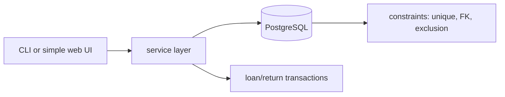

# Project 03 — Tool Library Database Application

## 1. Problem statement

A neighbourhood tool library lends drills, ladders and sewing machines to members. The current system
is a paper log and a group chat: two people lend the same drill, nobody knows who has the ladder, and
overdue items are discovered when someone asks for them. The data is small — a few hundred tools, a few
thousand loans — but the constraints matter, because the same physical object cannot be in two places.

The fix is a relational database with a small application on top: members, tools, loans and
reservations, with the invariants enforced by the schema and by transactions rather than by careful
typing. This project is about those invariants. A version that stores loans as free text "works" in a
demo and loses the ladder.

"Solved" means: the application can lend and return a tool atomically, refuse a second simultaneous
loan, list what is available now, and report overdue loans — and a deliberate crash mid-transaction
leaves the data consistent.

## 2. Intended users

| User | Goal | Skill level | Accessibility needs |
|---|---|---|---|
| Volunteer librarian | Lend and return tools during a two-hour shift | Basic computer use | Keyboard-only data entry; large labels; no hidden menus |
| Member | See availability, reserve a tool | Phone user, often outdoors | Readable on 360 px; works on slow connections |
| Coordinator | Run monthly reports on utilisation and overdue items | Spreadsheet-comfortable | Export to CSV |
| Auditor | Verify that loans and returns reconcile | SQL-comfortable | Read-only database access |

## 3. Functional requirements

- **FR-1** Register members with a unique email and a display name.
- **FR-2** Register tools with a unique asset tag, a name, a category and a condition.
- **FR-3** Lend an available tool to a member, recording the loan date and due date.
- **FR-4** Return a tool, recording the return date and optional condition note.
- **FR-5** Refuse a loan when the tool is already on loan; the refusal is observable and atomic.
- **FR-6** List tools available on a given date, including tools whose loan is due back that day.
- **FR-7** List overdue loans with member, tool and days overdue, ordered by days overdue.
- **FR-8** Reserve a tool that is on loan; a reservation becomes lendable when the tool returns.
- **FR-9** Search tools by name or category with a case-insensitive partial match.
- **FR-10** Export loans for a date range as CSV with a header row.
- **FR-11** Every mutation is wrapped in a transaction; a failed mutation leaves no partial state.

## 4. Non-functional requirements

| ID | Requirement | Measurable target |
|---|---|---|
| NFR-1 | Data integrity | The schema rejects a loan for a tool already on loan, even under two concurrent sessions |
| NFR-2 | Performance | Availability query returns in under 50 ms with 5,000 loans; search under 100 ms |
| NFR-3 | Correctness | Money-like values (fines) use `NUMERIC`, never floating point |
| NFR-4 | Recoverability | A documented backup and restore procedure recreates the database from a dump |
| NFR-5 | Portability | PostgreSQL 16 primary; SQLite permitted with the differences documented in an ADR |
| NFR-6 | Observability | Every mutation logs actor, entity, before and after state |

## 5. Prerequisites

| Lesson | Why needed here |
|---|---|
| [Database fundamentals](../../10-DATABASE-ENGINEERING/README.md) | Tables, keys, relationships |
| [SQL basics](../../10-DATABASE-ENGINEERING/README.md) | Joins, aggregates, subqueries for availability |
| [Normalisation](../../10-DATABASE-ENGINEERING/README.md) | The schema is graded on 3NF and justified denormalisation |
| [Transactions](../../10-DATABASE-ENGINEERING/README.md) | FR-5 and FR-11 are transactional requirements |
| [Indexes](../../10-DATABASE-ENGINEERING/README.md) | NFR-2 needs an index, not a bigger machine |
| [Testing fundamentals](../../14-TESTING-AND-QUALITY/testing-fundamentals.md) | Integration tests against a real database |

## 6. Architecture

A small application over a relational core. The database owns the invariants; the application owns
input validation and presentation.



**Yours to decide**: PostgreSQL versus SQLite; how the "tool is available" invariant is enforced
(partial unique index, exclusion constraint, or `SELECT ... FOR UPDATE` in a transaction); whether the
UI is a CLI or a small web page. **Given**: the entities in section 7 and the required uniqueness
constraints.

The central design question is where the invariant lives. An application-only check
(`SELECT` then `INSERT`) has a race: two sessions both see "available" and both insert. The schema-level
answers — a partial unique index on active loans, or `SERIALIZABLE` with retry — are what `NFR-1`
grades.

## 7. Data model

| Table | Columns | Constraints |
|---|---|---|
| `members` | `id`, `email`, `display_name`, `joined_at` | `email` unique, not null, lowercased |
| `tools` | `id`, `asset_tag`, `name`, `category`, `condition` | `asset_tag` unique; `condition` in a checked set |
| `loans` | `id`, `tool_id`, `member_id`, `lent_at`, `due_at`, `returned_at` | FK both ways; `due_at > lent_at`; `returned_at >= lent_at` |
| `reservations` | `id`, `tool_id`, `member_id`, `created_at`, `fulfilled_at` | FK both ways; one open reservation per member/tool |
| `fines` | `id`, `loan_id`, `amount`, `reason` | `amount NUMERIC(8,2) >= 0`; FK to loan |

Required invariants:

1. At most one **active** loan per tool: `UNIQUE (tool_id) WHERE returned_at IS NULL` (partial index).
2. A return cannot precede the loan (`CHECK`).
3. A tool cannot be deleted while loans exist (`ON DELETE RESTRICT`).
4. Reservation order is `created_at`, and only one open reservation per member per tool.

Everything else — categories table, condition history, member suspension — is yours to add if the
requirements need it, with the normalisation justified.

## 8. API contract

Either a CLI (`lib lend TOOL --member EMAIL --days 14`) or HTTP; the operations are fixed:

| Operation | Input | Success | Error cases |
|---|---|---|---|
| lend | tool tag, member email, days | loan id and due date | tool not found, member not found, already on loan |
| return | tool tag or loan id, condition note | return recorded | no active loan |
| available | date | list of tools | invalid date |
| overdue | as-of date | list with days overdue | invalid date |
| reserve | tool tag, member email | reservation id | tool available, duplicate open reservation |
| search | query, optional category | matching tools | empty query rejected |
| export | from, to | CSV on stdout | invalid range |

Errors are typed: `NotFound`, `Conflict` (already on loan), `Validation`. The service layer maps them
to exit codes or HTTP statuses; the database error text must not leak to the user.

## 9. UI requirements

If you build a web UI: a single page for the shift, with a search box focused on load, a list of
results, and a lend/return action per row. States: empty search, no results, conflict ("this tool is
on loan to Sam until Friday"), success with the due date. Keyboard-first: `/` focuses search, `Esc`
clears it.

If you build a CLI: table output with headers, an explicit confirmation line naming the member and the
due date after a lend, and exit codes that distinguish not-found from conflict.

Either way, the librarian is standing at a counter with a queue. Fewer than three interactions to lend.

## 10. Folder structure

```text
project-03-database-application/
├── README.md
├── db/
│   ├── 001_schema.sql        # tables, constraints, indexes
│   ├── 002_seed.sql          # 20 tools, 10 members, sample loans
│   └── 003_reporting.sql     # the availability and overdue queries
├── src/library/
│   ├── db.py                 # connection, transaction helper
│   ├── service.py            # lend, return, reserve, search
│   └── cli.py                # argument parsing, output
├── tests/
│   ├── test_schema.py        # constraints reject bad data
│   └── test_service.py       # transactions and conflicts
└── docs/adr/0001-*.md
```

## 11. Milestones

| # | Milestone | Deliverable | Depends on |
|---|---|---|---|
| M1 | Schema | Tables, constraints, seed data, ERD in the README | — |
| M2 | Core queries | Availability, overdue, search, run against seed | M1 |
| M3 | Lend and return | Transactions, conflict handling, integration tests | M2 |
| M4 | Reservations | Queue, fulfilment on return, one-open-per-member rule | M3 |
| M5 | Reporting | CSV export, monthly utilisation query | M2 |
| M6 | Operations | Backup/restore, migration script, indexes justified by `EXPLAIN` | M3 |

## 12. Implementation tasks

For M1 only:

1. Write `001_schema.sql` with the five tables and the four required invariants.
2. Add the partial unique index on active loans and confirm it rejects a second active loan.
3. Write `002_seed.sql` with data that exercises every constraint (including one overdue loan).
4. Draw the ERD in the README and state the cardinalities.
5. Write `test_schema.py` that asserts each constraint raises the expected error.

## 13. Testing strategy

| Requirement | Test level | Notes |
|---|---|---|
| FR-5, NFR-1 | integration | Two connections attempt the same loan; exactly one succeeds |
| FR-11 | integration | Force an error after the first write; assert no orphan row |
| FR-6 | integration | Fixture with a loan due today, one overdue, one returned |
| FR-7 | integration | Assert ordering and day arithmetic across a month boundary |
| FR-8 | integration | Reserve, return, then confirm the reservation is lendable |
| NFR-2 | performance | Seed 5,000 loans; `EXPLAIN ANALYZE` recorded in the README |
| NFR-4 | manual | Restore from dump into an empty database; run the acceptance queries |

Deliberately not tested: the ORM's behaviour (there is no ORM), and the exact wording of error
messages.

## 14. Security requirements

- **Least privilege** — the application connects as a role with `SELECT/INSERT/UPDATE` on its tables,
  not as the owner; `DELETE` only where the schema allows it.
- **Injection** — every query uses bound parameters; a test asserts that a tool name containing
  `'; DROP TABLE` is stored and returned verbatim.
- **No credentials in code** — connection settings come from environment variables; `.env.example`
  documents them without values.
- **PII minimisation** — members have an email and a display name; no address or phone number is
  stored unless a requirement needs it.
- **Audit** — the mutation log records actor and before/after state (NFR-6), which is also the evidence
  an auditor asks for.

## 15. Deployment plan

A PostgreSQL 16 instance plus the application. Minimum: `docker compose up` starts the database, applies
`001`/`002` on first run, and runs the CLI inside the same network. Health check: `SELECT 1` plus the
application's `--health` command. Rollback: migrations are forward-only and numbered; a failed
migration is restored from the pre-migration dump, whose command is in the README.

Backups: a nightly `pg_dump` to a local file, with a restore tested once and the date recorded. A backup
that has never been restored is a hope.

## 16. Documentation requirements

- `README.md`: ERD, how to start the database, how to apply schema and seed, the three main queries
  with `EXPLAIN` output, and the backup/restore procedure.
- One **ADR**: PostgreSQL versus SQLite, or how the availability invariant is enforced, or the
  reservation model.
- `003_reporting.sql` with a comment above each query naming the requirement it serves.

## 17. Acceptance criteria

- [ ] AC-1 `docker compose up` (or the documented equivalent) creates the schema and seed data with no
      manual SQL.
- [ ] AC-2 A second active loan for the same tool is rejected by the database, not just by the UI.
- [ ] AC-3 Two concurrent lend attempts result in exactly one loan (demonstrated by a test).
- [ ] AC-4 Returning a tool makes it available the same day and fulfils its earliest reservation.
- [ ] AC-5 The availability query returns the correct set for a fixture with active, returned and
      due-today loans.
- [ ] AC-6 The overdue report is ordered by days overdue and crosses a month boundary correctly.
- [ ] AC-7 Search for `dri` finds "Cordless drill" and "Drill bits" case-insensitively.
- [ ] AC-8 Export of a date range produces a CSV with a header and one row per loan.
- [ ] AC-9 A forced failure mid-transaction leaves no partial rows.
- [ ] AC-10 The availability and overdue queries are indexed: `EXPLAIN ANALYZE` shows no sequential scan
      on `loans` at 5,000 rows, and the plan is in the README.
- [ ] AC-11 Restoring the dump into an empty database and running AC-5 yields the same result.
- [ ] AC-12 The schema is in at least 3NF, and any denormalisation is named in an ADR.

## 18. Extension challenges

1. **Fines with a business calendar** — overdue fines that skip closed days. Teaches why storing a
   computed value is a decision with a maintenance cost.
2. **Loan extensions** — a member extends a loan if no reservation is waiting. Teaches conditional
   updates and fairness rules.
3. **Soft deletes and history** — retiring a tool while keeping loan history. Teaches temporal modelling
   without a second database.
4. **Reporting materialised view** — a monthly utilisation view refreshed on a schedule. Teaches the
   trade between freshness and query cost.
5. **Optimistic versus pessimistic locking** — implement both for the lend path and measure contention
   under 20 concurrent sessions. Teaches isolation levels with evidence.

## Solutions policy

A solution guide exists at [reference-solution/README.md](reference-solution/README.md), written after
this brief. The schema is the exercise; a guide read first removes exactly the practice this project
exists to provide.
