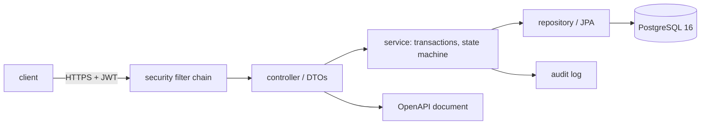

# Project 04 — Workshop Job Tracking REST API

## 1. Problem statement

A bicycle repair workshop tracks jobs on a whiteboard: a customer drops off a bike, a mechanic writes
the fault on a card, the card moves across four columns, and at pickup the card is thrown away. The
whiteboard cannot answer "how long did the last twenty brake jobs take", cannot tell a customer where
their bike is without a phone call, and loses the history of what was actually done.

This project is the service behind a replacement: an HTTP API for customers, jobs and job events, with
a real status machine, authentication, pagination, concurrency control and an OpenAPI description. The
UI is project 05's problem; here the contract is the product.

"Solved" means: a technician can create a job, move it through its allowed states, and read its
history over HTTP; a second client cannot silently overwrite a concurrent change; unauthorised callers
get `401`/`403` rather than data; and the published OpenAPI document matches the running service.

## 2. Intended users

| User | Goal | Skill level | Accessibility needs |
|---|---|---|---|
| Workshop coordinator | Create jobs, assign mechanics, find a job fast | Comfortable with a browser | Not applicable (API consumer); error messages must be actionable |
| Mechanic | Update job status from a phone | Basic | Small payloads; no multi-step flows |
| Shop owner | Read throughput and turnaround reports | Spreadsheet-comfortable | CSV export endpoint |
| Front-end developer | Build the counter UI against a stable contract | Professional | Accurate OpenAPI, stable error shape |
| Operator | Deploy, monitor and roll back | Professional | Health endpoints, structured logs, metrics |

## 3. Functional requirements

- **FR-1** Create a customer with a name and a unique email; return `201` with a `Location` header.
- **FR-2** Create a job for a customer with a device description, a reported fault and a priority.
- **FR-3** Read a job by id, including its ordered event history.
- **FR-4** List jobs with pagination (`page`, `size`, max 100), filtering by `status`, `assignee` and
  `priority`, and a case-insensitive search over device and fault text.
- **FR-5** Move a job through its status machine; reject a transition that is not allowed.
- **FR-6** Append an event to a job (note, status change, part ordered) with author and timestamp.
- **FR-7** Assign or reassign a technician to a job.
- **FR-8** Reject a status update based on a stale version (`If-Match`), returning `412`.
- **FR-9** Make job creation idempotent for a repeated `Idempotency-Key` within 24 hours.
- **FR-10** Authenticate bearer tokens and authorise by role: `COORDINATOR` (all writes), `TECHNICIAN`
  (status and events on assigned jobs), `VIEWER` (reads only).
- **FR-11** Return every error as `application/problem+json` with `type`, `title`, `status`, `detail`
  and `instance`.
- **FR-12** Serve an OpenAPI 3.1 document that describes every endpoint, schema and error response.
- **FR-13** Record an audit row for every status change: actor, from, to, timestamp.
- **FR-14** Export jobs for a date range as CSV.

## 4. Non-functional requirements

| ID | Requirement | Measurable target |
|---|---|---|
| NFR-1 | Latency | p95 under 200 ms for list and read at 100 requests/second against 50,000 jobs |
| NFR-2 | No N+1 | A job list of 50 jobs issues a bounded number of queries, independent of page size |
| NFR-3 | Correctness under concurrency | Two concurrent status changes with the same version: exactly one succeeds |
| NFR-4 | Contract stability | CI fails if the generated OpenAPI document changes without a version bump |
| NFR-5 | Operability | `/actuator/health/liveness` and `/readiness` respond; logs are JSON with a request id |
| NFR-6 | Security | No endpoint returns data without a valid token, and role rules are verified by test |
| NFR-7 | Migrations | Schema changes are versioned and applied automatically on start; forward-only |
| NFR-8 | Rate limiting | More than 60 requests/minute per token returns `429` with `Retry-After` |

## 5. Prerequisites

| Lesson | Why needed here |
|---|---|
| [Java fundamentals](../../04-JAVA-PROGRAMMING/README.md) | Types, collections, exceptions, generics |
| [Spring Boot basics](../../11-BACKEND-ENGINEERING/README.md) | Controllers, DI, configuration, validation |
| [REST design](../../11-BACKEND-ENGINEERING/http-and-rest-apis.md) | Resources, methods, status codes, pagination |
| [Sessions and tokens](../../11-BACKEND-ENGINEERING/sessions-and-tokens.md) | Bearer tokens, claims, expiry |
| [SQL and transactions](../../10-DATABASE-ENGINEERING/README.md) | Schema, indexes, isolation |
| [Testing fundamentals](../../14-TESTING-AND-QUALITY/testing-fundamentals.md) | Unit, slice and integration tests |
| [API security](../../15-APPLICATION-SECURITY/secure-api-design.md) | Authentication versus authorisation, rate limits |

## 6. Architecture

A layered Spring Boot service. Controllers own HTTP; services own the state machine and transactions;
repositories own SQL.



**Yours to decide**: JPA versus JDBC (both pass, with different trade-offs); token introspection versus
local JWKS validation; whether the audit log is a table or an event stream. **Given**: the resource
model, the status machine, and the error format.

The state machine is the core domain logic and belongs in a plain class with no Spring annotations, so
it can be unit-tested without a context.

## 7. Data model

| Table | Columns | Constraints |
|---|---|---|
| `customers` | `id`, `name`, `email`, `created_at` | `email` unique and lowercased |
| `jobs` | `id`, `customer_id`, `device`, `fault`, `priority`, `status`, `assignee_id`, `version`, `created_at`, `updated_at` | FK customer; `status` in the enum; `version` starts at 0 |
| `technicians` | `id`, `name`, `email`, `active` | `email` unique |
| `job_events` | `id`, `job_id`, `kind`, `author_id`, `body`, `from_status`, `to_status`, `created_at` | FK job `ON DELETE CASCADE`; ordered by `id` |
| `idempotency_keys` | `key`, `request_hash`, `response_status`, `response_body`, `created_at` | primary key `key`; expires after 24 h |
| `audit_log` | `id`, `actor_id`, `job_id`, `from_status`, `to_status`, `at` | append-only |

Indexes: `jobs (status, updated_at DESC)` for the default list; `jobs (assignee_id, status)`;
`job_events (job_id, id)`; a trigram or `lower(device || ' ' || fault)` index only if `EXPLAIN` shows the
search needs it.

The status machine:

```text
RECEIVED    -> DIAGNOSED, CANCELLED
DIAGNOSED   -> AWAITING_PARTS, IN_PROGRESS, CANCELLED
AWAITING_PARTS -> IN_PROGRESS, CANCELLED
IN_PROGRESS -> READY, AWAITING_PARTS, CANCELLED
READY       -> COLLECTED, IN_PROGRESS
COLLECTED   -> (terminal)
CANCELLED   -> (terminal)
```

`version` is a JPA `@Version` column exposed as an `ETag`; `If-Match` carries it back.

## 8. API contract

Base path `/api/v1`. Media type `application/json`; errors `application/problem+json`.

| Method | Path | Success | Notes |
|---|---|---|---|
| POST | `/customers` | 201 + `Location` | 409 on duplicate email |
| GET | `/customers/{id}` | 200 | 404 if none |
| POST | `/jobs` | 201 + `Location` + `ETag` | `Idempotency-Key` honoured (FR-9) |
| GET | `/jobs?status=&assignee=&priority=&q=&page=&size=` | 200 | `size` max 100, default 20 |
| GET | `/jobs/{id}` | 200 + `ETag` | includes events |
| PATCH | `/jobs/{id}/status` | 200 + new `ETag` | requires `If-Match`; 412 stale, 409 illegal transition |
| POST | `/jobs/{id}/events` | 201 | note or part ordered |
| PUT | `/jobs/{id}/assignee` | 200 | coordinator only |
| GET | `/jobs/export?from=&to=` | 200 `text/csv` | `Content-Disposition: attachment` |
| GET | `/openapi.json` | 200 | public, cacheable |

Pagination envelope: `{ "items": [...], "page": 0, "size": 20, "total": 137 }`, with `Link` headers for
`first`, `next`, `prev`, `last`.

Problem example:

```json
{
  "type": "https://example.org/problems/illegal-transition",
  "title": "Illegal status transition",
  "status": 409,
  "detail": "READY cannot move to DIAGNOSED",
  "instance": "/api/v1/jobs/41/status"
}
```

`detail` never contains a stack trace, a SQL fragment or an internal id.

## 9. UI requirements

The API is consumed by project 05, so the contract is the interface, but two consumer-facing
requirements still apply:

- **Error recoverability** — every `4xx` names the offending field or the illegal transition in `detail`,
  so a UI can show "This job is already collected" rather than "Request failed".
- **Bounded reads** — a list response is small enough to render on a phone: no endpoint returns more
  than 100 items, and a job's event list is paginated when it exceeds 100.

Document one worked example per endpoint in the README: request, response, and the error case.

## 10. Folder structure

```text
project-04-rest-api/
├── build.gradle.kts
├── src/main/java/shop/
│   ├── api/            # controllers, DTO records, problem mapping
│   ├── domain/         # Job, JobStatus, StatusMachine
│   ├── service/        # transactions, authorisation checks
│   ├── repo/           # Spring Data repositories, specifications
│   └── config/         # security, OpenAPI, Jackson, rate limit
├── src/main/resources/
│   ├── application.yml
│   └── db/migration/   # V1__schema.sql, V2__indexes.sql
├── src/test/java/      # unit, slice and integration tests
└── docs/adr/
```

## 11. Milestones

| # | Milestone | Deliverable | Depends on |
|---|---|---|---|
| M1 | Skeleton | Boot app, Postgres via compose, Flyway, health endpoint | — |
| M2 | Customers and jobs | Create/read, validation, problem+json, integration tests | M1 |
| M3 | State machine | Transition rules, `PATCH /status`, audit rows, unit tests | M2 |
| M4 | Listing and search | Pagination, filters, `Link` headers, no N+1 verified | M2 |
| M5 | Security | JWT validation, role checks, 401/403 tests, rate limit | M2 |
| M6 | Concurrency and idempotency | `ETag`/`If-Match`, `@Version`, idempotency table | M3 |
| M7 | Contract and operations | OpenAPI, CI diff check, JSON logs, CSV export | M4–M6 |

## 12. Implementation tasks

For M3 only:

1. Write `JobStatus` and `StatusMachine` as a plain class with `canTransition(from, to)` and a map of
   allowed transitions.
2. Unit-test every allowed and every disallowed pair — the table has 7×7 = 49 pairs, and the test is a
   loop, not 49 methods.
3. Add `PATCH /jobs/{id}/status` with `If-Match` required; return `428` when the header is missing.
4. Map an illegal transition to `409` with the problem type above.
5. Insert the audit row inside the same transaction as the status update; assert that a rollback removes
   both.

## 13. Testing strategy

| Requirement | Test level | Notes |
|---|---|---|
| FR-5 | unit | Transition table, every pair, including terminal states |
| FR-5 | slice (`@WebMvcTest`) | 409 shape and problem media type |
| FR-3, FR-4 | integration (Testcontainers) | Real Postgres; assert response bodies, not just status |
| NFR-2 | integration | Count queries via Hibernate statistics; assert ≤ 4 for a 50-job page |
| NFR-3 | integration | Two threads, same `ETag`; one 200, one 412 |
| FR-9 | integration | Same key twice returns the stored response; different body, same key returns 422 |
| FR-10 | slice + integration | No token 401; wrong role 403; expired token 401 with `WWW-Authenticate` |
| NFR-4 | CI check | Regenerate OpenAPI, diff against the committed copy |
| NFR-1 | load | k6 or Gatling script in `perf/`, results in the README |

Deliberately not tested: framework behaviour (pagination plumbing), and the exact JSON key order.

## 14. Security requirements

- **Authentication** — validate JWT signature against the issuer's JWKS, check `iss`, `aud`, `exp` and
  `nbf`; reject `alg: none` and algorithm confusion by pinning the expected algorithm.
- **Authorisation** — enforce in the service layer, not only in the controller, and test that a
  `TECHNICIAN` cannot modify a job assigned to someone else.
- **Mass assignment** — request DTOs are records with explicit fields; no entity is bound directly from
  JSON, so `status` and `assignee` cannot be set on create.
- **Injection** — parameterised queries only; a test sends `%' OR 1=1 --` in `q` and asserts zero rows
  and no error detail.
- **Transport and headers** — HTTPS assumed at the edge; HSTS set there; API sends
  `Cache-Control: no-store` on authenticated responses.
- **Rate limiting** — per token, 60/minute, `429` + `Retry-After`; the limit is configuration, not a
  constant in code.
- **Logging** — never log tokens, `Authorization` headers or full request bodies; a test asserts the
  token string does not appear in captured log output.
- **Errors** — a global handler converts every uncaught exception to a problem document with no stack
  trace; `server.error.include-stacktrace=never`.

## 15. Deployment plan

Multi-stage Dockerfile producing a JRE 21 image running as a non-root user. `docker compose up` starts
the API and PostgreSQL, applies Flyway migrations and seeds a demo technician.

Configuration through environment variables (`SPRING_DATASOURCE_URL`, `JWT_ISSUER`, `JWT_AUDIENCE`);
no secret in `application.yml`. Health: liveness on `/actuator/health/liveness`, readiness includes the
database. Rollback: keep the previous image tag; migrations are forward-only, so a rollback that crosses
a migration requires the pre-deploy dump — document the command and test it once.

Metrics: request count, latency histogram and error rate on `/actuator/prometheus`. Alerts: 5xx rate
above 1% for five minutes, p95 above 500 ms for ten minutes.

## 16. Documentation requirements

- `README.md`: how to run, the endpoint table, one request/response example per endpoint, the status
  machine diagram, the token format expected, and the load-test result.
- `openapi.json` committed and served, with a CI check that it matches the code.
- Two **ADRs**: JPA versus JDBC, and the idempotency design.
- A short `docs/authorisation.md` matrix: role × endpoint × allowed.

## 17. Acceptance criteria

- [ ] AC-1 `docker compose up` starts the API against Postgres and `/actuator/health/readiness` returns
      `UP`.
- [ ] AC-2 `POST /customers` returns 201 with `Location`; a duplicate email returns a 409 problem.
- [ ] AC-3 `POST /jobs` returns 201 with `ETag`; a repeated `Idempotency-Key` returns the same body and
      status without creating a second job.
- [ ] AC-4 `GET /jobs` paginates, filters and searches; `size=101` returns 400; `Link` headers present.
- [ ] AC-5 Every legal transition succeeds; every illegal one returns 409 with the problem type, proven
      by a table-driven test.
- [ ] AC-6 `PATCH /status` without `If-Match` returns 428; with a stale value returns 412.
- [ ] AC-7 Two concurrent updates from the same version produce exactly one success.
- [ ] AC-8 Requests without a token get 401 with `WWW-Authenticate`; a `VIEWER` writing gets 403.
- [ ] AC-9 The 61st request in a minute on one token returns 429 with `Retry-After`.
- [ ] AC-10 The OpenAPI document validates as 3.1 and covers every endpoint and error response; CI fails
      when it drifts.
- [ ] AC-11 A 50-job page issues a bounded number of SQL statements (statistics output in the README).
- [ ] AC-12 The load test at 100 rps shows p95 under 200 ms, with the report committed.

## 18. Extension challenges

1. **Optimistic versus pessimistic locking** — add `SELECT ... FOR UPDATE` behind a flag and compare
   throughput under contention. Teaches where retries belong.
2. **ETag on collections** — a conditional `GET /jobs` with `If-None-Match`, returning 304. Teaches
   cache validation and its correctness traps.
3. **Outbox for events** — publish job events to a queue via a transactional outbox. Teaches why
   "write then publish" is two failures waiting to happen.
4. **Rate limiting with a sliding window** — replace a fixed window with a token bucket in Redis.
   Teaches burst behaviour and the boundary bug of fixed windows.
5. **Multi-tenancy** — add a `tenant_id` and enforce it in every query, with a test that a token from one
   tenant cannot read another's job. Teaches the hardest authorisation bug to find late.

## Solutions policy

A solution guide exists at [reference-solution/README.md](reference-solution/README.md), written after
this brief. Read it after your transition table and your concurrency test exist, not before.
