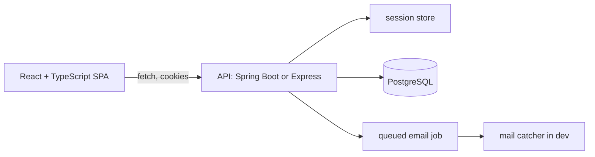

# Project 05 — Community Kitchen Rota (Full-Stack Application)

## 1. Problem statement

A community kitchen serves lunch five days a week and runs on a rota: two cooks and one server per
shift. The rota lives in a spreadsheet that one volunteer updates by hand, and the group chat asks "who
is on Friday?" three times a week. When someone drops out, the spreadsheet is edited and nobody notices
the gap until the food is not made.

The application replaces the spreadsheet with a week view that volunteers can claim from and
coordinators can fill. It is the first project where the browser, the server, the database and the
session all have to agree, and most of the difficulty is at those seams: a claim that two people make at
once, a page that shows a slot as taken while the request is still in flight, a session that expires
while a form is open.

"Solved" means: a volunteer signs in, claims a free slot, sees it appear immediately, and cannot claim a
slot someone else took a moment earlier; a coordinator can create and fill slots; and every
authorisation decision is made on the server, not in the React tree.

## 2. Intended users

| User | Goal | Skill level | Accessibility needs |
|---|---|---|---|
| Volunteer | Claim or release a shift in under a minute, on a phone | Basic | 360 px layout; 44 px targets; works with one hand |
| Coordinator | Fill gaps, see the week at a glance, contact volunteers | Comfortable | Keyboard-first admin table; bulk actions |
| Kitchen lead | Read the rota for next week, print it | Basic | Print stylesheet; no reliance on colour |
| New volunteer | Understand what a shift involves before claiming | Basic | Plain language; descriptions per role |

## 3. Functional requirements

- **FR-1** Sign up with email and password; sign in and sign out; sessions survive a page reload.
- **FR-2** Show the current week's shifts grouped by day, with role, time, location and filled/free state.
- **FR-3** Claim a free slot; the claim is atomic and a second claim on the same slot fails observably.
- **FR-4** Release a slot the signed-in volunteer holds; coordinators may release any slot.
- **FR-5** Filter the week by role and by "only free slots".
- **FR-6** Coordinator-only: create, edit and delete shifts for a week.
- **FR-7** Show "My shifts" for the signed-in volunteer across all weeks.
- **FR-8** Reject unauthorised mutations on the server: a volunteer cannot create shifts or release
  another volunteer's claim.
- **FR-9** Show a clear conflict message when a claim loses the race, and refresh the slot's state.
- **FR-10** Validate forms on the client for speed and on the server for truth, with the same rules.
- **FR-11** Email a confirmation when a volunteer claims a shift (a queued job, not a blocking send).
- **FR-12** Provide a print-friendly week view with no interactive controls.

## 4. Non-functional requirements

| ID | Requirement | Measurable target |
|---|---|---|
| NFR-1 | First meaningful paint | Under 2.0 s on a throttled "Fast 3G" profile, cold cache |
| NFR-2 | Interaction latency | A claim reflects in the UI within 100 ms (optimistic), confirmed within 500 ms |
| NFR-3 | Accessibility | WCAG 2.2 AA on the volunteer flow; axe reports zero serious issues |
| NFR-4 | Session security | `HttpOnly`, `Secure`, `SameSite=Lax` cookie; rotation on sign-in; 30-minute idle timeout |
| NFR-5 | Integrity | Two concurrent claims on one slot: exactly one succeeds, proven by test |
| NFR-6 | Resilience | A failed claim rolls the optimistic UI back and tells the user why |
| NFR-7 | Bundle size | Initial JS under 180 KB gzipped, measured in CI |
| NFR-8 | Operability | One command runs the whole stack locally; health check on the API |

## 5. Prerequisites

| Lesson | Why needed here |
|---|---|
| [HTML and CSS foundations](../../07-HTML-AND-CSS/README.md) | Layout and the print stylesheet |
| [JavaScript fundamentals](../../08-JAVASCRIPT-AND-TYPESCRIPT/javascript-fundamentals.md) | Async, fetch, errors |
| [TypeScript fundamentals](../../08-JAVASCRIPT-AND-TYPESCRIPT/README.md) | Typed props, API types, discriminated unions |
| [React fundamentals](../../09-FRONTEND-ENGINEERING/README.md) | Components, state, effects, forms |
| [Reusable components](../../09-FRONTEND-ENGINEERING/reusable-components.md) | The slot card and the admin table |
| [Accessibility](../../09-FRONTEND-ENGINEERING/accessibility.md) | NFR-3 and the keyboard flow |
| [HTTP and REST](../../11-BACKEND-ENGINEERING/http-and-rest-apis.md) | Status codes, caching, error shapes |
| [Sessions and tokens](../../11-BACKEND-ENGINEERING/sessions-and-tokens.md) | Cookie sessions and CSRF |
| [CSRF](../../15-APPLICATION-SECURITY/csrf.md) | Why a cookie session needs a token |
| [End-to-end testing](../../14-TESTING-AND-QUALITY/README.md) | The Playwright flow |

## 6. Architecture

A single-page React application and an HTTP API, deployed as two processes behind one origin in
production (reverse proxy) and two ports in development (Vite proxy).



**Yours to decide**: Spring Boot or Node/Express for the API; React Query or hand-written hooks; CSS
modules, Tailwind or plain CSS; whether email is a database-backed queue or an in-process job with a
retry table. **Given**: the data model, the cookie session requirement, and the server-side
authorisation rules.

One decision is not free: the session must be an `HttpOnly` cookie, because `NFR-4` is graded and
storing a token in `localStorage` fails it. A cookie session brings CSRF with it, so the CSRF token is
part of the design, not an afterthought.

## 7. Data model

| Table | Columns | Constraints |
|---|---|---|
| `users` | `id`, `email`, `name`, `password_hash`, `role`, `created_at` | `email` unique, lowercased; `role` in (`VOLUNTEER`, `COORDINATOR`) |
| `sessions` | `id`, `user_id`, `token_hash`, `created_at`, `last_seen_at`, `expires_at` | FK user; `token_hash` unique; index on `expires_at` |
| `shifts` | `id`, `date`, `start_time`, `end_time`, `role`, `capacity`, `notes` | `end_time > start_time`; `capacity` 1–6; unique `(date, start_time, role)` |
| `claims` | `id`, `shift_id`, `user_id`, `created_at`, `released_at` | FK both; unique `(shift_id, user_id) WHERE released_at IS NULL` |
| `outbox` | `id`, `kind`, `payload`, `attempts`, `next_attempt_at`, `sent_at` | index on `(sent_at, next_attempt_at)` |

Capacity is on the shift, not implied by the number of claims, so a shift can need two cooks and one
server. `claims` counts toward `capacity`; the claim transaction locks the shift row, counts active
claims and inserts, which is the same pattern as project 03 with more contention.

The outbox row is written in the claim transaction and sent by a worker; `FR-11` says the email is
queued, so the claim must not fail because SMTP is down.

## 8. API contract

Base path `/api`. All mutations require the session cookie and the `X-CSRF-Token` header.

| Method | Path | Success | Notes |
|---|---|---|---|
| POST | `/auth/signup` | 201 + `Set-Cookie` | 409 duplicate email |
| POST | `/auth/signin` | 200 + `Set-Cookie` | 401 generic message; rate limited |
| POST | `/auth/signout` | 204 | Clears the cookie and the session row |
| GET | `/me` | 200 | 401 when signed out; includes role |
| GET | `/weeks/{isoWeek}` | 200 | Shifts with `claimed`, `capacity`, `mine` |
| POST | `/shifts/{id}/claims` | 201 | 409 if full or already claimed |
| DELETE | `/shifts/{id}/claims/me` | 204 | 404 if not claimed |
| DELETE | `/shifts/{id}/claims/{userId}` | 204 | coordinator only; 403 otherwise |
| POST | `/shifts` | 201 | coordinator only |
| PATCH | `/shifts/{id}` | 200 | coordinator only |
| DELETE | `/shifts/{id}` | 204 | coordinator only; 409 if claims exist |
| GET | `/me/shifts` | 200 | upcoming claims, ordered by date |
| GET | `/weeks/{isoWeek}/print` | 200 HTML | public, no controls |

Errors are `application/problem+json` with `type`, `title`, `status`, `detail`, and for validation a
`errors` array of `{field, message}`. The front-end renders `detail` for conflicts and `errors` beside
fields.

## 9. UI requirements

**Screens**: sign in, sign up, week view, my shifts, admin week editor.

**Week view states** — loading (skeleton matching the slot card shape, not a spinner), empty week
("Nothing scheduled; ask the coordinator"), free slot, claimed by me, claimed by someone else, full,
conflict toast. Each state is designed, not an accident of conditional rendering.

**Optimistic claim** — the button switches to "Claiming…" and the card shows the slot as yours
immediately; on `409` it reverts with a message naming the other volunteer if the API returns it. The
revert must not lose the user's scroll position.

**Keyboard** — arrow keys move between slots in a day, `Enter` claims, `R` releases with confirmation.
The admin table supports editing without a mouse.

**Accessibility specifics** — status changes are announced via an `aria-live="polite"` region; colour is
never the only signal (the "full" state has a label as well as a tint); focus is visible on the dark
header; the sign-in error is associated with its fields via `aria-describedby`.

**Print** — `/weeks/{isoWeek}/print` and a `@media print` rule that hides navigation, removes
backgrounds and shows the week on one page.

## 10. Folder structure

```text
project-05-full-stack-application/
├── web/
│   ├── src/
│   │   ├── api/            # typed client, error mapping, query keys
│   │   ├── components/     # SlotCard, WeekGrid, AdminTable, Toast
│   │   ├── routes/         # Week, MyShifts, SignIn, Admin
│   │   └── lib/            # dates (isoWeek), validation rules
│   └── e2e/                # Playwright specs
├── api/
│   ├── src/main/java/.../  # or src/ for Node
│   │   ├── auth/           # session, CSRF, password hashing
│   │   ├── shifts/         # controller, service, repository
│   │   └── outbox/         # worker
│   └── db/migration/
└── docker-compose.yml
```

## 11. Milestones

| # | Milestone | Deliverable | Depends on |
|---|---|---|---|
| M1 | Walking skeleton | Vite app, API, Postgres, one endpoint rendered | — |
| M2 | Auth | Sign up/in/out, cookie session, CSRF, `/me` guard | M1 |
| M3 | Week view | Read-only week, states, responsive layout | M2 |
| M4 | Claims | Claim and release, atomic capacity, optimistic UI + rollback | M3 |
| M5 | Admin | Shift CRUD, server-side role checks, admin table | M4 |
| M6 | Notifications | Outbox, worker, dev mail catcher | M4 |
| M7 | Quality and deploy | Playwright flow, axe, bundle budget, one-command run | M5–M6 |

## 12. Implementation tasks

For M2 only:

1. Create the `users` and `sessions` tables; hash passwords with Argon2id or bcrypt cost ≥ 12.
2. Implement sign-in: verify the hash, create a session row, set an `HttpOnly` cookie with a random
   256-bit token whose hash is stored.
3. Add CSRF: a double-submit token in a readable cookie, echoed in `X-CSRF-Token`, verified on every
   mutation.
4. Add `/me` and a route guard that redirects to sign-in and back to the requested URL.
5. Test: wrong password gives 401 with the same message as unknown email; a mutation without the CSRF
   header gives 403; the cookie is not readable from `document.cookie`.

## 13. Testing strategy

| Requirement | Test level | Notes |
|---|---|---|
| FR-1, NFR-4 | integration | Session cookie flags, rotation on sign-in, expiry after idle |
| FR-3, NFR-5 | integration | Two concurrent claims; one 201, one 409, capacity respected |
| FR-8 | integration | Volunteer token on admin endpoints: 403, no state change |
| FR-9, NFR-6 | component | Mock a 409; assert optimistic state reverts and the message shows |
| FR-10 | unit + integration | Shared validation rules; server rejects what the client rejects |
| FR-2, FR-12 | e2e (Playwright) | Sign in, see the week, claim, see "My shifts", print view loads |
| NFR-3 | manual + axe | Keyboard walkthrough of the claim flow; axe on three pages |
| NFR-1, NFR-7 | CI | Lighthouse budget and bundle-size check |

Deliberately not tested: third-party UI behaviour, and pixel-level layout. Visual checks are the
reviewer's job.

## 14. Security requirements

- **Password storage** — Argon2id (preferred) or bcrypt with cost ≥ 12; never SHA-256, never unsalted.
- **Session fixation** — issue a new session token on sign-in and invalidate the old one.
- **CSRF** — double-submit token plus `SameSite=Lax`; `SameSite=None` only if a cross-site embed needs it.
- **Authorisation** — every mutation checks role and ownership on the server; the React guard is a UX
  affordance, not a control.
- **Injection** — parameterised SQL; the API never interpolates request values into SQL or HTML.
- **XSS** — React escapes by default; the one `dangerouslySetInnerHTML` is banned unless it is static,
  trusted copy. A CSP with no `unsafe-inline` for scripts.
- **Rate limiting** — sign-in 5 attempts per 15 minutes per IP+email, then 429.
- **Enumeration** — sign-in and sign-up do not reveal whether an email exists.
- **Logging** — no passwords, tokens or session ids; log the user id, not the email, at info level.
- **Dependencies** — `npm audit` and the backend's dependency check run in CI; a known high advisory
  fails the build.

## 15. Deployment plan

Two containers plus Postgres, behind one origin so the cookie is first-party:

```text
browser -> reverse proxy (TLS, HSTS) -> /api -> api:8080
                                     -> /*   -> web static files
```

Static assets are hashed and cached for a year; `index.html` is `no-store`. The API sets
`Secure` cookies because the proxy terminates TLS and forwards `X-Forwarded-Proto`; the app trusts that
header only from the proxy. Migrations run on API start. Rollback: previous image tags for both
containers; database changes are additive for one release so a rollback does not need a restore.

Health: `/api/health` checks the database and returns `{"status":"ok"}`. A smoke test after deploy signs
in with a seeded account and claims a slot in a test week, then releases it.

## 16. Documentation requirements

- `README.md`: one-command start, seeded accounts, the endpoint table, the claim conflict rule, and how
  to run the e2e suite.
- `docs/authorisation.md`: the role × action matrix, and where each rule is enforced.
- One **ADR**: cookie sessions versus bearer tokens, with the CSRF consequence.
- One **runbook**: what to do when sign-in fails, when the outbox backs up, and how to rotate the
  session signing key.

## 17. Acceptance criteria

- [ ] AC-1 `docker compose up` plus `npm run dev` runs the stack; the week view loads seeded data.
- [ ] AC-2 Sign up, sign out and sign in work; the session survives a reload and expires after 30 idle
      minutes.
- [ ] AC-3 The session cookie is `HttpOnly`, `Secure` in production mode and `SameSite=Lax`.
- [ ] AC-4 A mutation without `X-CSRF-Token` returns 403; with it, succeeds.
- [ ] AC-5 Claiming a free slot updates the UI within one frame and persists after reload.
- [ ] AC-6 Two simultaneous claims on a full slot: exactly one succeeds and the other sees a conflict.
- [ ] AC-7 A failed claim reverts the optimistic UI and shows the reason.
- [ ] AC-8 A volunteer calling `POST /shifts` gets 403 and no row is created.
- [ ] AC-9 A volunteer cannot release another volunteer's claim; a coordinator can.
- [ ] AC-10 The week view passes axe with zero serious issues, is usable at 360 px, and is fully
      keyboard-operable.
- [ ] AC-11 The print view renders the week with no controls and no clipped days.
- [ ] AC-12 The Playwright flow passes from a clean database, and the initial bundle is under 180 KB
      gzipped.

## 18. Extension challenges

1. **Recurring shifts** — generate a week from a template, with exceptions. Teaches the difference between
   a rule and its instances.
2. **Waitlist** — a full shift takes a waitlist and promotes automatically on release. Teaches
   transactional fairness and notification ordering.
3. **Calendar export** — an `.ics` feed per volunteer. Teaches time zones and a format with sharp edges.
4. **Offline read cache** — the week view still renders from a service worker cache when offline, with a
   clear stale banner. Teaches cache invalidation in the browser.
5. **Role delegation** — a coordinator invites another, with an audit trail. Teaches privilege
   escalation paths, which is where real vulnerabilities live.

## Solutions policy

A solution guide exists at [reference-solution/README.md](reference-solution/README.md), written after
this brief. The seams — session, CSRF, optimistic rollback — are the learning; read the guide after you
have hit at least one of them.
