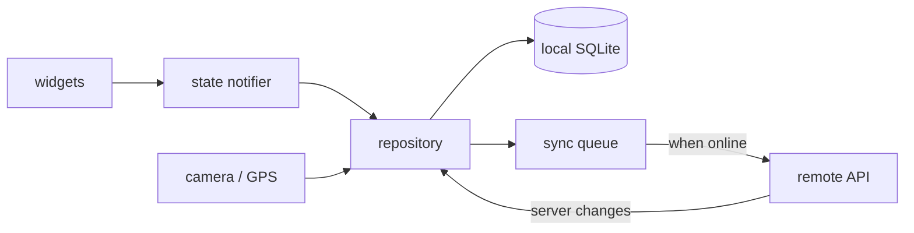

# Project 06 — Field Survey Mobile App (Flutter)

## 1. Problem statement

Wildlife volunteers survey the same five wetland sites every month. They record what they see on paper,
photograph the page, and type it up at home — often a week later, often with the location wrong. The
data is good; the process loses it.

This project is the field app: record an observation with a photo, a count, a species and the phone's
location while standing in a reed bed with no signal, then sync when there is one. Offline is the normal
case, not an error state. The hard parts are not the screens: they are a local database that survives a
crash, an upload queue that is safe to retry, and a merge rule that does not silently lose a volunteer's
edit.

"Solved" means: the app records observations with no network, restarts with them intact, syncs when
connectivity returns without duplicating any, resolves a conflicting edit predictably, and never blocks
the volunteer behind a spinner waiting for a server.

## 2. Intended users

| User | Goal | Skill level | Accessibility needs |
|---|---|---|---|
| Field volunteer | Record 20 observations in an hour, outdoors, gloves on | Basic | One-handed use; large targets; high-contrast in sunlight; screen reader support |
| Survey coordinator | Confirm uploads, chase gaps, export the season | Comfortable | Web-side export; no app requirement |
| New volunteer | Learn the app in five minutes with no training | Basic | Inline guidance; forgiving input; no modal mazes |
| Volunteer with low vision | Read counts and species names outdoors | Basic | Dynamic type up to 200%; no text in images |

## 3. Functional requirements

- **FR-1** Sign in once and stay signed in; the session works offline after the first sign-in.
- **FR-2** Create an observation: photo, species (from a local list), count, notes, site, timestamp.
- **FR-3** Capture the current location; allow manual site selection when the fix is poor or absent.
- **FR-4** Works fully offline: list, create, edit and delete observations with no network.
- **FR-5** Persist across app kill and device restart; no observation is lost after a crash.
- **FR-6** Queue unsynced observations and upload them when connectivity returns, in the background.
- **FR-7** Sync is idempotent: retrying an upload never creates a duplicate on the server.
- **FR-8** Detect an edit conflict (same observation changed on the server) and apply a documented rule.
- **FR-9** Show sync state per observation: `pending`, `syncing`, `synced`, `failed` with a retry action.
- **FR-10** Filter observations by site, species and sync state.
- **FR-11** Export the local set as CSV to the share sheet.
- **FR-12** Warn before deleting an unsynced observation and offer to keep it.

## 4. Non-functional requirements

| ID | Requirement | Measurable target |
|---|---|---|
| NFR-1 | Cold start | Interactive under 2.5 s on a mid-range Android device with 1,000 local observations |
| NFR-2 | List performance | Scrolling 1,000 rows at 60 fps; no jank in a recorded profile |
| NFR-3 | Storage | 500 observations with photos under 250 MB; images downscaled before storage |
| NFR-4 | Battery | Background sync under 1% battery per hour while idle |
| NFR-5 | Reliability | Killing the app during an upload never duplicates or loses an observation |
| NFR-6 | Accessibility | WCAG-equivalent AA contrast; all controls reachable with TalkBack/VoiceOver |
| NFR-7 | Privacy | Location stored at reduced precision (5 decimal places) and never sent to analytics |
| NFR-8 | Portability | Android 10+ and iOS 16+ from one codebase |

## 5. Prerequisites

| Lesson | Why needed here |
|---|---|
| [Dart fundamentals](../../12-MOBILE-DEVELOPMENT/README.md) | Null safety, async, collections, isolates |
| [Flutter widgets and layout](../../12-MOBILE-DEVELOPMENT/README.md) | Composition, constraints, responsive layout |
| [State management](../../12-MOBILE-DEVELOPMENT/README.md) | The chosen approach (Riverpod, Bloc or provider) |
| [Local storage](../../12-MOBILE-DEVELOPMENT/README.md) | SQLite via drift or sqflite |
| [Networking and JSON](../../12-MOBILE-DEVELOPMENT/README.md) | HTTP client, serialisation, timeouts |
| [Mobile testing](../../12-MOBILE-DEVELOPMENT/mobile-testing.md) | Unit, widget and integration tests |
| [iOS release](../../12-MOBILE-DEVELOPMENT/ios-release.md) | Permissions, signing, store metadata |

## 6. Architecture

Offline-first: the local database is the source of truth for the UI; the network is a sync transport.



**Yours to decide**: Riverpod or Bloc; drift or sqflite; `workmanager`/`BGTaskScheduler` versus a
foreground sync on resume; how photos are stored (file path in the row, bytes in the database is the
wrong answer). **Given**: the local schema, the sync-state machine and the idempotency requirement.

The rule that keeps this simple: the UI never waits for the network. Every write lands in SQLite first,
sets `pending`, and returns. Sync is a separate concern that reads the queue.

## 7. Data model

Local SQLite:

| Table | Columns | Notes |
|---|---|---|
| `observations` | `id` (uuid, client-generated), `server_id`, `species`, `count`, `notes`, `site_id`, `lat`, `lon`, `photo_path`, `observed_at`, `updated_at`, `sync_state`, `server_version` | `id` is the idempotency key |
| `sites` | `id`, `name`, `lat`, `lon` | seeded, refreshable |
| `species` | `id`, `common_name`, `scientific_name` | seeded from a bundled asset |
| `sync_queue` | `id`, `observation_id`, `operation`, `attempts`, `last_error`, `next_attempt_at` | one row per pending operation |
| `meta` | `key`, `value` | last sync cursor, session expiry |

`sync_state` is a small state machine: `pending -> syncing -> synced`, and `syncing -> failed -> pending`
on retry. A row in `syncing` at app start is the crash case; the recovery rule is to treat it as
`pending` and let idempotency make the retry safe. That rule is `NFR-5` and it is one line of code that
must be tested by killing the app mid-upload.

Conflict: the server returns `409` with its current version. The documented rule is **field-level
last-write-wins on `notes` and `count`, with the server keeping the original photo**. Whatever you
choose, it must be written in the README and tested, because "we merge somehow" is the answer that fails
`FR-8`.

## 8. API contract

| Method | Path | Notes |
|---|---|---|
| POST | `/auth/token` | Returns a long-lived refresh token; cached for offline use |
| GET | `/sites` | Cached on first sync |
| GET | `/species?updated_since=` | Cached; supports delta refresh |
| POST | `/observations` | Requires `Idempotency-Key: <client uuid>`; 201 or 200 on replay |
| PATCH | `/observations/{serverId}` | Requires `If-Match: <server_version>`; 409 on conflict |
| DELETE | `/observations/{serverId}` | Soft delete; 404 treated as success |
| GET | `/observations?since=` | Delta pull for server-side changes |
| POST | `/photos` | Multipart; returns a photo id, uploaded before the observation |

The client generates the uuid, so a retried `POST` is the same key and the server returns the first
result. Photos upload first; the observation references the returned id, which keeps the observation
payload small enough to retry cheaply.

## 9. UI requirements

**Screens**: sign in, observation list, new/edit observation, detail with photo, settings/sync status.

**List** — grouped by date, each row showing species, count, site and a small sync badge with a text
label ("Pending", "Synced") not just a colour. Pull-to-refresh triggers sync but does not block; the
list stays usable.

**Capture** — one screen, three taps to save: species picker, count stepper, save. The photo is optional
but prompted. Location shows "Locating…" then the site name, with a "Choose site" fallback that is never
hidden behind an error.

**States** — empty ("No observations yet — tap + to record one"), first-run permission explanation
before the OS dialog, sync failure with a retry button and the reason, offline banner that is informative
rather than alarming.

**Accessibility** — every icon button has a semantic label; count stepper supports swipe and buttons;
text scales to 200% without clipping; the camera flow has a non-camera path (choose from gallery).

## 10. Folder structure

```text
project-06-flutter-mobile-app/
├── lib/
│   ├── main.dart
│   ├── data/           # database, dao, api client, sync engine
│   ├── domain/         # Observation, SyncState, conflict rules
│   ├── features/       # list, capture, detail, settings
│   └── core/           # theme, router, permissions, result types
├── assets/             # species.json, site list, sample images
├── test/               # unit and widget tests
├── integration_test/   # end-to-end on a device or emulator
└── android/ ios/       # platform configuration
```

## 11. Milestones

| # | Milestone | Deliverable | Depends on |
|---|---|---|---|
| M1 | Local-first skeleton | SQLite schema, list from database, seeded species | — |
| M2 | Capture | Form, photo, GPS, save to database, survives restart | M1 |
| M3 | Sync queue | Queue, worker, idempotent POST, state badges | M2 |
| M4 | Conflict and delta | `409` handling, server pull, merge rule + tests | M3 |
| M5 | Polish | Empty/error states, accessibility pass, dynamic type | M2 |
| M6 | Background and release | Background sync, permissions, signed build, store listing draft | M4 |

## 12. Implementation tasks

For M3 only:

1. Add `sync_queue` writes in the same SQLite transaction as the observation write, so a crash cannot
   leave an observation with no queue row.
2. Implement the worker: select due rows, mark `syncing`, upload photo then observation, update
   `server_id`/`server_version`, delete the queue row — all in one transaction.
3. On failure, increment `attempts` and set `next_attempt_at` with exponential backoff plus jitter.
4. On app start, reset rows stuck in `syncing` to `pending`.
5. Test with a fake API: success, 500 then success, timeout then success, and a kill between upload and
   the local update.

## 13. Testing strategy

| Requirement | Test level | Notes |
|---|---|---|
| FR-5, NFR-5 | integration | Kill the process during upload (fake API with a delay); restart; no duplicate |
| FR-7 | unit | Same uuid posted twice returns the same server id; local row not duplicated |
| FR-8 | unit | Every conflict case in the table, including both fields changed |
| FR-4 | widget | List and create with the API client throwing on every call |
| NFR-1 | profile | `flutter run --profile` on a mid-range device; timeline in the README |
| NFR-2 | profile | Scroll 1,000 seeded rows; no frame over 16 ms in the recorded trace |
| NFR-6 | manual | TalkBack/VoiceOver walkthrough of the capture flow; contrast check |
| FR-11 | unit | CSV escaping for a note containing a comma and a quote |

Deliberately not tested: the OS camera and the real GPS (fake the platform channels), and store review
behaviour.

## 14. Security requirements

- **Token storage** — refresh token in the platform keystore/keychain (`flutter_secure_storage`), not in
  `SharedPreferences`.
- **Transport** — HTTPS only; certificate validation not disabled, even in debug builds.
- **Local data** — observations are not sensitive, but the token is; the database file is not world
  readable and photos live in app-private storage.
- **Permissions** — camera and location requested at the point of use, with a rationale; denial leaves
  the app usable (manual site, no photo).
- **Privacy** — coordinates rounded to five decimal places before storage (NFR-7); no analytics SDK
  receives a location or a note.
- **Logging** — no tokens or coordinates in logs; release builds strip debug logging.
- **Backups** — the app excludes the token from Android auto-backup.

## 15. Deployment plan

Android: signed App Bundle with an upload key, `versionCode` incremented per release, internal testing
track first. iOS: a development build on a device, TestFlight internal group, `Info.plist` usage strings
for camera and location. A CI job builds both and fails on analyzer warnings; signing secrets live in CI
secrets, never in the repository.

The backend for this project can be the project 04 API extended with an observations resource, or a
small purpose-built service. Document which, with its base URL in a build-time configuration
(`--dart-define`), not hard-coded in a widget.

Crash reporting is optional; if used, it must not attach coordinates or notes, and the README says so.

## 16. Documentation requirements

- `README.md`: how to run on an emulator, seed the database, run tests, and build a signed artifact.
- `docs/sync.md`: the state machine, the idempotency key, the backoff policy, and the conflict rule with
  one worked example.
- `docs/permissions.md`: what is requested, when, and what happens on denial.
- One **ADR**: Riverpod versus Bloc, or drift versus sqflite, with the consequence for testing.

## 17. Acceptance criteria

- [ ] AC-1 With the device in airplane mode, create, edit and delete observations; all persist after a
      restart.
- [ ] AC-2 After re-enabling the network, pending observations upload without user action and the badges
      change to "Synced".
- [ ] AC-3 Killing the app during an upload, then restarting, produces exactly one server observation.
- [ ] AC-4 A server-side edit to the same observation produces the documented conflict outcome, with the
      user informed.
- [ ] AC-5 A failed upload shows "Failed" with a retry that succeeds once the server recovers.
- [ ] AC-6 The list renders 1,000 observations without jank in a profile trace included in the README.
- [ ] AC-7 The capture flow works with TalkBack/VoiceOver and at 200% text scale.
- [ ] AC-8 Camera and location denial leave a usable path with manual site selection and gallery import.
- [ ] AC-9 CSV export opens the share sheet and escapes commas and quotes correctly.
- [ ] AC-10 No token appears in logs or in `SharedPreferences`; the token lives in secure storage.
- [ ] AC-11 `flutter analyze` is clean and the unit/widget suite passes on CI.
- [ ] AC-12 A signed Android artifact installs on a device; the iOS build runs on TestFlight or a device.

## 18. Extension challenges

1. **Photo compression pipeline** — resize and re-encode off the UI isolate. Teaches isolates and why
   image work on the main thread is the classic jank source.
2. **Multi-device sync** — two devices, one account, server changes pulled on start. Teaches delta sync
   and a cursor that survives a reinstall.
3. **Bulk entry** — record a count per species in one pass for a transect. Teaches batch transactions and
   a form that stays fast with 40 rows.
4. **Offline maps** — cache a tile set for a site. Teaches storage budgets and licence constraints.
5. **Background sync on iOS** — `BGTaskScheduler` with its time budget. Teaches that "background" means
   "maybe" and the UI must not depend on it.

## Solutions policy

A solution guide exists at [reference-solution/README.md](reference-solution/README.md), written after
this brief. The sync engine is the project; read the guide after your queue survives its first kill test.
