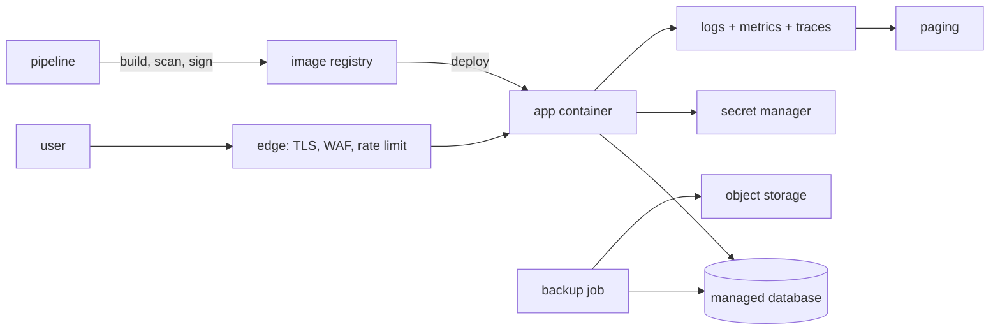

# Project 07 — Take an Application to Production

## 1. Problem statement

An application that runs on a laptop is a demo. One that strangers can use — while you sleep, under
load, under attack, and after you have forgotten how it works — is a product. The distance between the
two is not a feature: it is a threat model, a pipeline, a deployment that can be reversed, telemetry that
tells you what is wrong, a backup you have restored, and a document that tells the next person what to do
at 03:00.

This project takes an application you already built (projects 04, 05, 06 or a capstone-scale service) and
makes it production-grade. You are not judged on new screens. You are judged on whether a hostile
reviewer can find a way in, whether a bad deploy can be undone in minutes, and whether you can prove the
service is healthy from the outside.

"Solved" means: the service is deployed to a public URL over HTTPS with a working pipeline; a failed
deploy rolls back automatically; there is a threat model with each mitigation traceable to code or
configuration; an SLO with alerts that fire on symptoms; and a restore from backup that has actually
been performed and timed.

## 2. Intended users

| User | Goal | Skill level | Accessibility needs |
|---|---|---|---|
| End user | Use the app without noticing operations | Basic | The app's own accessibility bar still applies |
| On-call engineer | Diagnose and restore service from a page | Professional | Runbook readable on a phone at 03:00 |
| Security reviewer | Find the weakest control and its evidence | Professional | Threat model with file/line references |
| Auditor | Confirm backups, access and change control | Professional | Dated evidence, not claims |
| Future maintainer | Change the system without breaking it | Professional | Architecture and ADRs that match reality |

## 3. Functional requirements

- **FR-1** Deploy to a public HTTPS endpoint from a pipeline, with no manual steps on the server.
- **FR-2** A staging environment that mirrors production's shape (same images, same migrations, smaller
  instance) and is deployed before production.
- **FR-3** A failing health check during deploy aborts and restores the previous version automatically.
- **FR-4** Every deploy is traceable: commit, image digest, migration set, deployer, timestamp.
- **FR-5** Secrets come from a secret manager and are rotatable without a code change.
- **FR-6** Structured logs with a request id, correlated to traces, with no secrets or personal data.
- **FR-7** Metrics for traffic, errors, latency and saturation, with dashboards for each.
- **FR-8** Alerts on user-visible symptoms (error rate, latency, availability), wired to a paging channel.
- **FR-9** An SLO with an error budget and a written policy for what happens when the budget is spent.
- **FR-10** A tested backup and restore procedure, including a measured restore time.
- **FR-11** A threat model covering the deployed system, with each mitigation mapped to its control.
- **FR-12** A runbook with the five most likely incidents and the first three actions for each.
- **FR-13** A load test at the target traffic that reports p95/p99 and the first bottleneck.
- **FR-14** A cost estimate for the deployed shape, with the dominant line item identified.

## 4. Non-functional requirements

| ID | Requirement | Measurable target |
|---|---|---|
| NFR-1 | Availability | 99.5% monthly, measured by an external probe, not by the app's own logs |
| NFR-2 | Deploy safety | Rollback completes in under 5 minutes; zero-downtime for a routine deploy |
| NFR-3 | Security posture | No critical or high findings in SAST, dependency or container scans at release |
| NFR-4 | Recovery | RPO 24 h, RTO 1 h, demonstrated by a dated restore drill |
| NFR-5 | Observability | Any 5xx spike is detected within 2 minutes by an alert that names the endpoint |
| NFR-6 | Access control | Production access is least-privilege, MFA-enforced, and logged |
| NFR-7 | Reproducibility | A clean clone plus documented secrets reproduces the deployment |
| NFR-8 | Performance | p95 under 300 ms at 3× expected peak, with the load-test report committed |

## 5. Prerequisites

| Lesson | Why needed here |
|---|---|
| [Software development life cycle](../../13-SOFTWARE-ENGINEERING-AND-ARCHITECTURE/README.md) | Environments, change management |
| [Requirements engineering](../../13-SOFTWARE-ENGINEERING-AND-ARCHITECTURE/requirements-engineering.md) | Turning the SLO into testable requirements |
| [Security testing](../../15-APPLICATION-SECURITY/README.md) | SAST, dependency and container scanning |
| [Threat modelling](../../15-APPLICATION-SECURITY/threat-modeling.md) | STRIDE over the deployed system |
| [Cloud fundamentals](../../17-CLOUD-AND-PRODUCTION/README.md) | Compute, networking, storage, IAM |
| [Observability](../../17-CLOUD-AND-PRODUCTION/README.md) | Logs, metrics, traces, alerting |
| [Incident response](../../17-CLOUD-AND-PRODUCTION/README.md) | Severity, roles, communication |
| [Reliability engineering](../../18-ADVANCED-ENGINEERING/reliability-engineering.md) | SLOs, error budgets, toil |
| [CI/CD](../../11-BACKEND-ENGINEERING/README.md) | Pipeline stages and gates |

## 6. Architecture

A deployed system, described as it actually runs, not as it was designed.



**Yours to decide**: the platform (a PaaS, a VM with compose, or a managed container service); the
deployment strategy (rolling, blue-green, canary); the observability stack (hosted or self-run).
**Given**: HTTPS at the edge, a pipeline with gates, an external availability probe, and a database whose
backups you restore once.

The single most important architectural decision is what you do **not** operate yourself. A managed
database removes backup, patching and failover from your on-call load; self-hosting it is a legitimate
choice only if the brief's learning goal is the database, which it is not.

## 7. Data model

This project adds operational state to the existing schema:

| Table | Purpose | Notes |
|---|---|---|
| `deployments` | One row per deploy | commit, image digest, migration version, actor, started/finished, status |
| `feature_flags` | Canary and kill switches | name, enabled, rollout percentage, updated_by |
| `audit_events` | Who changed what | actor, action, target, before/after hash, at |
| `outbox` / `jobs` | Background work already present | unchanged; now monitored |

Existing data gets a **retention policy**: anything with personal data has a stated lifetime and a
deletion path, because `NFR-6` and the threat model both ask what happens to it. A `users` table with no
retention decision is an audit finding.

Migrations are forward-only, applied by the pipeline before the new image serves traffic, and must be
compatible with the previous version for one release (expand/contract), or `NFR-2`'s zero-downtime
target is impossible.

## 8. API contract

The application's own API is unchanged. This project adds:

| Method | Path | Notes |
|---|---|---|
| GET | `/health/live` | Process is up; no dependencies |
| GET | `/health/ready` | Database reachable, migrations current; 503 otherwise |
| GET | `/metrics` | Prometheus format, restricted to the internal network |
| GET | `/version` | Commit, build time, image digest; public, no secrets |
| POST | `/admin/flags/{name}` | Authenticated, audited; sets rollout percentage |
| GET | `/admin/deployments` | Authenticated; last 20 deploys with status |

The distinction between liveness and readiness is load-bearing: a liveness probe that checks the
database restarts every app instance during a database blip, turning a degradation into an outage.

## 9. UI requirements

No new product UI. Three operational interfaces still have to be usable:

- **Status page or `/status`** — current availability from the external probe, last incident, and a
  subscribe link. It must be hosted separately from the app it reports on.
- **Dashboard** — one screen answering "is it healthy": request rate, error rate, p95, saturation,
  database connections, deploy markers as vertical lines.
- **Runbook** — plain Markdown, printable, with commands that can be copy-pasted. A runbook that says
  "check the logs" is not a runbook; it says which query, which dashboard panel and which threshold.

Accessibility still applies to the status page: it is the page people read when they are already
frustrated.

## 10. Folder structure

```text
project-07-secure-production-application/
├── app/                      # the existing application, unchanged except for health, logs, metrics
├── deploy/
│   ├── Dockerfile
│   ├── compose.yml           # local parity
│   ├── k8s/ or fly.toml      # production shape
│   └── backup/               # dump + upload + restore scripts
├── .github/workflows/ci.yml
├── observability/
│   ├── dashboards/*.json
│   ├── alerts.yml
│   └── slo.md
├── security/
│   ├── threat-model.md
│   ├── sbom/                 # generated, committed per release
│   └── scan-results/         # dated evidence
├── docs/
│   ├── runbook.md
│   ├── incident-2026-*.md    # one real or simulated incident
│   └── adr/
└── loadtest/k6.js
```

## 11. Milestones

| # | Milestone | Deliverable | Depends on |
|---|---|---|---|
| M1 | Deployable | Image, pipeline, staging deploy, health endpoints | — |
| M2 | Safe deploys | Migration gate, readiness gate, automatic rollback test | M1 |
| M3 | Observable | Structured logs, metrics, trace correlation, dashboard | M1 |
| M4 | Alertable | SLO, error budget, symptom alerts, external probe | M3 |
| M5 | Secure | Threat model, scans, headers, secret manager, least privilege | M1 |
| M6 | Recoverable | Backups, restore drill with timing, runbook | M1 |
| M7 | Proven | Load test at 3× peak, incident exercise, cost review | M2–M6 |

## 12. Implementation tasks

For M2 only:

1. Add `/health/live` and `/health/ready`; readiness fails when migrations are behind.
2. Make the pipeline run migrations as a distinct step before switching traffic.
3. Implement the deploy as a new container alongside the old one, with traffic switched only after
   readiness passes three times in a row.
4. On readiness failure or a 5% error rate in the first five minutes, switch traffic back and mark the
   deployment failed in `deployments`.
5. Test the rollback by deploying a deliberately broken image to staging and timing the recovery.

## 13. Testing strategy

| Requirement | Test level | Notes |
|---|---|---|
| FR-3, NFR-2 | staging drill | Deploy a broken image; measure detection and rollback time |
| NFR-4 | restore drill | Restore last night's dump into a scratch database; time it; run a smoke query |
| NFR-3 | CI gate | SAST, dependency scan, image scan, SBOM; fail on critical/high |
| FR-11 | review | Threat model walkthrough with a second person, findings tracked |
| NFR-5 | alert test | Inject 100 5xx responses; confirm the page fires within 2 minutes |
| NFR-8 | load | k6 at 3× peak for 10 minutes; p95/p99, error rate, saturation |
| NFR-1 | probe | External check every minute from two regions; 30-day rolling availability |
| FR-10 | manual | One documented, dated restore; RTO compared to the target |

Deliberately not tested: the cloud provider's own failure modes, and DDoS beyond the edge's defaults.

## 14. Security requirements

- **Threat model** — STRIDE over the deployed diagram, with trust boundaries drawn. Every mitigation
  names its control: a header in `nginx.conf`, a `@PreAuthorize`, a database grant, a WAF rule.
- **Transport** — TLS 1.2+, HSTS with a one-year max-age, no mixed content; an A grade on a TLS scan.
- **Headers** — CSP (enforced, with `report-uri`), `X-Content-Type-Options`, `Referrer-Policy`,
  `Permissions-Policy`, frame ancestors denied.
- **Secrets** — injected at runtime from the platform's secret store; no `.env` in the image; rotation
  documented and performed once (even if simulated) so the procedure is known to work.
- **Access** — production shell access is break-glass, MFA, logged; the pipeline uses a scoped token, not
  a personal one; database credentials are per-application, not owner.
- **Dependencies and images** — pinned digests, SBOM per release, no `latest`, non-root container, read-only
  filesystem where possible.
- **Rate limiting and abuse** — at the edge per IP, in the app per account for expensive endpoints.
- **Data protection** — encryption at rest for the database and backups; personal data minimised and
  retained per policy; logs scrubbed of tokens, passwords and full request bodies.
- **Audit** — admin actions and deploys recorded with actor and time.

## 15. Deployment plan

That is this project. Concretely: one pipeline, three gates (tests, scans, staging smoke), then
production behind a flag or a canary. Migrations are expand/contract and run before the switch. The
previous two images stay available for rollback; the rollback command is in the runbook and was
exercised in M2.

Backups: nightly full dump plus point-in-time recovery if the managed database offers it. Restore drill
recorded with date, duration and the person who ran it. Backups are encrypted and stored in a different
account or region from the database.

Costs: a written estimate with the dominant line (usually the database or egress), the monthly total, and
one thing you would change at 10× traffic. Review the bill against the estimate after a week.

## 16. Documentation requirements

- `README.md`: the public URL, the architecture diagram as deployed, how to deploy, how to roll back.
- `security/threat-model.md`: diagram, trust boundaries, threats, mitigations, residual risks, owner.
- `docs/runbook.md`: five incidents, each with symptoms, first three actions, escalation, and how to
  confirm recovery.
- `observability/slo.md`: the SLI definition, the target, the window, the error budget and the policy.
- `docs/incident-*.md`: one post-incident review in blameless format, with action items and owners.
- One **ADR** per significant operational choice: platform, deployment strategy, observability stack.

## 17. Acceptance criteria

- [ ] AC-1 The app is reachable over HTTPS at a public URL with a valid certificate and an A-grade TLS
      scan committed.
- [ ] AC-2 Pushing to `main` deploys to staging automatically, and to production behind an explicit
      approval or a green staging smoke.
- [ ] AC-3 A deliberately broken deploy to staging is rolled back automatically in under 5 minutes, with
      the timing recorded.
- [ ] AC-4 `/health/live` and `/health/ready` behave differently: stopping the database fails readiness
      only.
- [ ] AC-5 CSP is enforced (not report-only) and the app works with it; the policy is in the repo.
- [ ] AC-6 The release has zero critical/high SAST, dependency and image findings, with dated reports.
- [ ] AC-7 No secret exists in the image or repository; rotating one requires no code change, and a
      rotation was performed.
- [ ] AC-8 An injected 5xx spike pages within 2 minutes, and the alert names the endpoint and the SLO.
- [ ] AC-9 The SLO, error budget and budget-exhausted policy are written and linked from the dashboard.
- [ ] AC-10 A restore from backup was performed and timed, and the record is in the repo.
- [ ] AC-11 The load test at 3× peak reports p95 under 300 ms and identifies the first bottleneck.
- [ ] AC-12 The runbook's first incident was exercised (real or simulated) and produced a post-incident
      review with owned action items.

## 18. Extension challenges

1. **Canary with automatic analysis** — route 5% of traffic to the new version and promote only if its
   error rate is within the baseline. Teaches the statistics of small samples and why canaries lie.
2. **Chaos exercise** — kill the database for 60 seconds during business hours. Teaches what actually
   degrades versus what pages.
3. **Multi-region read replica** — serve reads from a second region and measure the consistency cost.
   Teaches latency budgets and replication lag.
4. **Cost regression gate** — fail the pipeline if the estimated monthly cost rises more than 20%. Teaches
   the cost of an innocent-looking instance-size change.
5. **Security regression suite** — turn the threat model's mitigations into automated tests (headers,
   authz matrix, rate limits) that run on every deploy. Teaches controls that stay fixed.

## Solutions policy

A solution guide exists at [reference-solution/README.md](reference-solution/README.md), written after
this brief. The evidence is the deliverable here; read the guide after your first rollback drill, when
you know which parts of your deployment are actually reversible.
