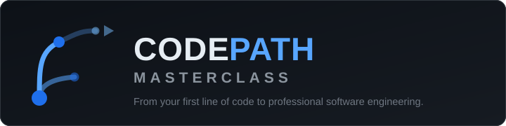

# CODEPATH MASTERCLASS

**From Your First Line of Code to Professional Software Engineering.**

[](LICENSE)
[](CURRICULUM-MAP.md)



---

Welcome. This repository is a **complete, structured, self-study software engineering curriculum**
written as a textbook you can read, run, edit, and contribute to — not a list of links to other
people's tutorials.

It takes you from "I have never written a line of code" all the way to building, testing, securing,
deploying, and maintaining real software systems: web applications, REST APIs, databases, and
mobile apps.

Every lesson explains the **what, the why, and the trade-offs** — not just the syntax. Every
substantial lesson ends with exercises, measurable completion criteria, and a short knowledge check,
because reading about a concept is not the same as knowing it.

---

## Who this is for

| If you are… | Start at… |
|---|---|
| **A complete beginner** who has never programmed | [00-START-HERE](00-START-HERE/README.md), then follow the roadmap top to bottom |
| **A student** who knows some programming but wants structured depth | [00-START-HERE/prerequisite-map.md](00-START-HERE/prerequisite-map.md) to place yourself, then jump to your gap |
| **A working developer** who wants to fill specific gaps (testing, security, DevOps, system design) | The [table of contents](#table-of-contents) below, or the [Curriculum Map](CURRICULUM-MAP.md) |
| **Preparing for interviews or a first job** | [19-PROFESSIONAL-DEVELOPMENT](19-PROFESSIONAL-DEVELOPMENT/README.md) and [20-PROJECT-LABORATORY](20-PROJECT-LABORATORY/README.md) |

## What this repository is — and is not

**It is:**

- A progressive path where every lesson lists its prerequisites and links to the lesson that teaches them.
- Real explanations with runnable examples, diagrams, common mistakes, and exercises that
  progress from guided practice to independent problem-solving.
- A reference library: glossary, command references, error catalogs, and official documentation links.
- Honest about its own status: unfinished work is tracked publicly in
  [ISSUE-STORE/ISSUE-REGISTER.md](ISSUE-REGISTER.md) and reported in the completion report.

**It is not:**

- A certificate or a guarantee of employment. Reading a repository is not mastery — building,
  debugging, breaking, and maintaining software is.
- A "become an expert in 30 days" plan. The roadmap is organized around competence gates, not
  calendars.
- A substitute for official documentation. Where a detail is version-sensitive, this repository
  points you at the vendor's own reference (see [VERSIONS.md](VERSIONS.md)).

---

## How the learning path is organized

The curriculum moves in one direction: **nothing is taught before the thing it depends on.**

| # | Subject | You leave able to… |
|---|---|---|
| 00 | [Start Here](00-START-HERE/README.md) | Use the repository, plan study, and understand how programs work at all |
| 01 | [Computer Foundations](01-COMPUTER-FOUNDATIONS/README.md) | Explain what a computer, a process, memory, and binary actually are |
| 02 | [Programming Fundamentals](02-PROGRAMMING-FUNDAMENTALS/README.md) | Think algorithmically and write loops, functions, and modular programs |
| 03 | [Developer Tools](03-DEVELOPER-TOOLS/README.md) | Live in the terminal, manage files, and use Git/GitHub with confidence |
| 04 | [Java Programming](04-JAVA-PROGRAMMING/README.md) | Write typed, object-oriented programs and reason about the JVM |
| 05 | [Data Structures & Algorithms](05-DATA-STRUCTURES-AND-ALGORITHMS/README.md) | Choose data structures and analyze correctness and cost with Big-O |
| 06 | [Internet & Web Foundations](06-INTERNET-AND-WEB-FOUNDATIONS/README.md) | Trace a request from your browser to a server and back |
| 07 | [HTML & CSS](07-HTML-AND-CSS/README.md) | Build semantic, responsive, accessible pages |
| 08 | [JavaScript & TypeScript](08-JAVASCRIPT-AND-TYPESCRIPT/README.md) | Write modern async JS and enforce contracts with types |
| 09 | [Frontend Engineering with React](09-FRONTEND-ENGINEERING/README.md) | Build component-driven interfaces with state, routing, and tests |
| 10 | [Database Engineering](10-DATABASE-ENGINEERING/README.md) | Design normalized schemas, write SQL, and reason about indexes and transactions |
| 11 | [Backend Engineering](11-BACKEND-ENGINEERING/README.md) | Build a tested, secure Spring Boot REST API backed by PostgreSQL |
| 12 | [Mobile Development](12-MOBILE-DEVELOPMENT/README.md) | Build and release a Flutter app that talks to a real API |
| 13 | [Software Engineering & Architecture](13-SOFTWARE-ENGINEERING-AND-ARCHITECTURE/README.md) | Choose the simplest architecture that fits the requirements |
| 14 | [Testing & Quality](14-TESTING-AND-QUALITY/README.md) | Design a test pyramid and gate quality in CI |
| 15 | [Application Security](15-APPLICATION-SECURITY/README.md) | Prevent, find, and verify fixes for common vulnerabilities |
| 16 | [DevOps & Infrastructure](16-DEVOPS-AND-INFRASTRUCTURE/README.md) | Containerize, pipeline, and operate software on Linux |
| 17 | [Cloud & Production](17-CLOUD-AND-PRODUCTION/README.md) | Deploy, scale, observe, and control cloud cost |
| 18 | [Advanced Engineering](18-ADVANCED-ENGINEERING/README.md) | Design distributed systems and profile real performance bottlenecks |
| 19 | [Professional Development](19-PROFESSIONAL-DEVELOPMENT/README.md) | Run professional workflows, reviews, interviews, and a portfolio |
| 20 | [Project Laboratory](20-PROJECT-LABORATORY/README.md) | Ship 7 guided projects plus a capstone that combines everything |
| 21 | [Reference Library](21-REFERENCE-LIBRARY/README.md) | Look up glossary, commands, status codes, and errors fast |

**Full sequence with milestone gates:** [ROADMAP.md](ROADMAP.md)
**Competency → lesson → exercise → project lookup:** [CURRICULUM-MAP.md](CURRICULUM-MAP.md)

---

## Table of contents

### Using this repository

- [LEARNING-GUIDE.md](LEARNING-GUIDE.md) — how to study this material so it actually sticks
- [ROADMAP.md](ROADMAP.md) — the full curriculum in order, with promotion criteria between milestones
- [CURRICULUM-MAP.md](CURRICULUM-MAP.md) — every competency mapped to its lessons, exercises, and projects
- [PROGRESS-TRACKER.md](PROGRESS-TRACKER.md) — your manual progress log across eight skill dimensions
- [VERSIONS.md](VERSIONS.md) — the exact tool versions every example is written against
- [LABS.md](LABS.md) — the lab environment behind every "executed" transcript, and how to rebuild it
- [ISSUE-REGISTER.md](ISSUE-REGISTER.md) — what is written, what is not, and what comes next
- [templates/](templates/lesson-template.md) — the structure every lesson follows
- [scripts/](scripts/README.md) — validation tooling that checks structure and links
- [assets/](assets/README.md) — diagrams and visual learning material, with source and license records

### The curriculum

- [00-START-HERE/](00-START-HERE/README.md) — orientation, how programs work, study method
- [01-COMPUTER-FOUNDATIONS/](01-COMPUTER-FOUNDATIONS/README.md) — hardware, OS, files, binary, memory, execution
- [02-PROGRAMMING-FUNDAMENTALS/](02-PROGRAMMING-FUNDAMENTALS/README.md) — algorithms, variables, control flow, functions, debugging
- [03-DEVELOPER-TOOLS/](03-DEVELOPER-TOOLS/README.md) — terminal, Linux, editors, environment variables, Git, GitHub, code review
- [04-JAVA-PROGRAMMING/](04-JAVA-PROGRAMMING/README.md) — Java from first program to concurrency and the JVM
- [05-DATA-STRUCTURES-AND-ALGORITHMS/](05-DATA-STRUCTURES-AND-ALGORITHMS/README.md) — Big-O, core structures, sorting, recursion, DP, graphs
- [06-INTERNET-AND-WEB-FOUNDATIONS/](06-INTERNET-AND-WEB-FOUNDATIONS/README.md) — IP, DNS, TCP, HTTP, TLS, browsers
- [07-HTML-AND-CSS/](07-HTML-AND-CSS/README.md) — semantic markup, forms, Flexbox, Grid, responsive design, accessibility
- [08-JAVASCRIPT-AND-TYPESCRIPT/](08-JAVASCRIPT-AND-TYPESCRIPT/README.md) — JS fundamentals, DOM, async, then TypeScript's type system
- [09-FRONTEND-ENGINEERING/](09-FRONTEND-ENGINEERING/README.md) — React, state, routing, API integration, design systems, performance
- [10-DATABASE-ENGINEERING/](10-DATABASE-ENGINEERING/README.md) — relational design, SQL, transactions, indexes, migrations, PostgreSQL
- [11-BACKEND-ENGINEERING/](11-BACKEND-ENGINEERING/README.md) — HTTP and REST, Spring Boot, JPA, auth, caching, testing, logging
- [12-MOBILE-DEVELOPMENT/](12-MOBILE-DEVELOPMENT/README.md) — Dart, Flutter, state, offline, permissions, testing, store releases
- [13-SOFTWARE-ENGINEERING-AND-ARCHITECTURE/](13-SOFTWARE-ENGINEERING-AND-ARCHITECTURE/README.md) — requirements, SOLID, patterns, architecture styles, technical debt
- [14-TESTING-AND-QUALITY/](14-TESTING-AND-QUALITY/README.md) — unit to E2E, mocking, TDD, coverage, performance and security testing, quality gates
- [15-APPLICATION-SECURITY/](15-APPLICATION-SECURITY/README.md) — threat modeling, auth security, injection, XSS, CSRF, SSRF, secrets, labs
- [16-DEVOPS-AND-INFRASTRUCTURE/](16-DEVOPS-AND-INFRASTRUCTURE/README.md) — Linux ops, Docker, Compose, Nginx, IaC, CI/CD, deployment, monitoring
- [17-CLOUD-AND-PRODUCTION/](17-CLOUD-AND-PRODUCTION/README.md) — VMs, cloud networking, storage, IAM, load balancing, scaling, incidents, cost
- [18-ADVANCED-ENGINEERING/](18-ADVANCED-ENGINEERING/README.md) — concurrency, messaging, database scaling, system design, reliability
- [19-PROFESSIONAL-DEVELOPMENT/](19-PROFESSIONAL-DEVELOPMENT/README.md) — workflows, reviews, documentation, open source, interviews, career
- [20-PROJECT-LABORATORY/](20-PROJECT-LABORATORY/README.md) — seven graded projects and a capstone
- [21-REFERENCE-LIBRARY/](21-REFERENCE-LIBRARY/README.md) — glossary, common errors, command and language references

### Repository meta

- [CONTRIBUTING.md](CONTRIBUTING.md) — how to propose improvements to lessons or exercises
- [CODE_OF_CONDUCT.md](CODE_OF_CONDUCT.md) — expected behaviour in issues and discussions
- [SECURITY.md](SECURITY.md) — how to report a security problem found in this material
- [SUPPORT.md](SUPPORT.md) — where to get help, and what is and is not supported
- [CHANGELOG.md](CHANGELOG.md) — what changed, batch by batch
- [LICENSE](LICENSE) — MIT

---

## How to use exercises

Every substantive lesson ends with a ladder of practice:

1. **Introductory exercises** — reproduce and slightly modify what the lesson showed.
2. **Intermediate exercises** — combine ideas, handle edge cases, break things on purpose.
3. **An independent task** — a small problem stated without steps, requiring you to design the solution.

**Rules that make this work:**

- Attempt before you look. Solutions live in separate folders — `exercises/solutions/` inside each
  subject, and `reference-solution/` inside each project — and they open with a warning header.
- Write the code yourself, run it, make it fail, and read the error. Copying a solution produces the
  *feeling* of knowledge without the knowledge.
- Every exercise states how to tell when you are done ("completion criteria"). If you cannot satisfy
  the criteria, you are not done —rerun the lesson's knowledge check first.

Projects in [20-PROJECT-LABORATORY](20-PROJECT-LABORATORY/README.md) are where lessons combine:
each one names the subjects it assesses, its acceptance criteria, and its extension challenges.

## How to track your progress

[PROGRESS-TRACKER.md](PROGRESS-TRACKER.md) tracks eight dimensions separately — concepts
understood, exercises completed, projects implemented, tests written, bugs diagnosed, documentation
written, independent problem-solving, and deployment experience — using six proficiency levels:

1. **Introduced** · 2. **Practiced with guidance** · 3. **Implemented independently** ·
4. **Applied in a complete project** · 5. **Explained and reviewed critically** ·
6. **Maintained in a realistic environment**

These are learning indicators for self-reflection, **not certifications**. Opening a lesson moves
you to level 1 at most; only building and explaining moves you further.

## Quality and validation

This repository validates itself with lightweight scripts (structure and links) plus an honest,
manual quality review (a script can confirm a heading exists; it cannot confirm that the lesson
actually teaches well):

```bash
python scripts/check-links.py        # every relative link and image path resolves
python scripts/check-curriculum.py   # required directories, READMEs, and lesson sections exist
```

Known limits are disclosed, never hidden: lessons whose commands could not be executed on the
author's machine say so (see [VERSIONS.md](VERSIONS.md)).

## Contributing

Found a mistake, an unclear explanation, or a missing example? Read [CONTRIBUTING.md](CONTRIBUTING.md).
Issues should state which lesson is affected and what a learner would have understood incorrectly.

## Maintainer

Created and maintained by **Felix Haule**.

## License

[MIT](LICENSE) — free to use, fork, and adapt with attribution preserved.

---

### ➡ Start here: [00-START-HERE/README.md](00-START-HERE/README.md)

*What this repository will and will not do for you, how to use it, and the one habit that
determines whether you finish.*