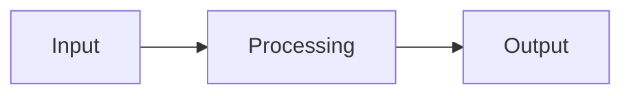

# Lesson Title

<!--
AUTHORING RULES (delete this comment block when the lesson is written)
- Every H2 section below is required for a substantive lesson. Reference/overview pages may omit
  sections that genuinely do not apply — but never omit: Learning Objectives, Prerequisites,
  Core Concepts, Practical Exercises, Completion Criteria, Summary.
- "Prerequisites" must link to the actual repository file that teaches each dependency.
- Every code example: valid syntax, complete enough to compile/run, with imports, expected output,
  how to run it, and whether the transcript was executed on a real machine or is an illustration.
- Every exercise: observable completion criteria. Solutions go to a separate solutions/ folder.
- Explain every technical term the first time it is used. No unexplained jargon.
- A diagram is optional; never add one that teaches nothing, and never put essential information
  only inside an image.
-->

## 1. Learning Objectives

After this lesson you will be able to:

- [ ] Objective 1 — written as an observable action (write, run, explain, diagnose, compare)
- [ ] Objective 2
- [ ] Objective 3

## 2. Prerequisites

- [Prerequisite lesson name](../path/to/prerequisite.md) — teaches X, which this lesson builds on
- If no prerequisite exists, state: *"No prerequisites — this lesson assumes nothing."*

## 3. Introduction

What the subject is, in plain language, and why a learner should care about it before seeing any
syntax.

## 4. The Problem It Solves

The practical situation that made this concept or technology necessary. What did people do before
it? What went wrong with that?

## 5. Core Concepts

Break the subject into small, ordered parts. Define each new term **before** using it.

### Concept A

### Concept B

## 6. How It Works

The underlying mechanism, step by step, including a diagram where a diagram genuinely helps:



Explain the diagram's key elements in the surrounding prose — the image is support, not the lesson.

## 7. Practical Examples

**Example 1 — minimal case**

```lang
// complete, runnable, with imports
```

- What the important lines do
- **Expected output:**
- **How to run it:**
- **Assumptions:** (tool versions from VERSIONS.md, OS, etc.)

**Example 2 — realistic use case** (same structure)

## 8. Real-World Applications

Where professionals use this, in which kinds of systems, and what it is usually paired with.

## 9. Common Mistakes

| Mistake | Why it happens | How to recognize it | How to prevent it |
|---|---|---|---|
| | | | |

## 10. Best Practices

Practice, each with its reasoning. Do not present preferences as universal rules — say when the
"rule" stops applying.

## 11. Limitations and Trade-Offs

Costs, constraints, and situations where a different approach is better.

## 12. Practical Exercises

### Introductory

1. **Exercise 1.1** — task, then **Completion criteria:** observable pass condition
2. **Exercise 1.2**

### Intermediate

3. **Exercise 1.3** — usually combining edge cases or two ideas
4. **Exercise 1.4**

### Independent problem-solving

5. **Exercise 1.5** — stated as a problem, not steps. The learner designs the solution.
   **Completion criteria:** how to know it is done.

*Solutions: attempt first. They live in `solutions/` of this subject.*

## 13. Knowledge Check

1. Question that tests understanding, not recall. …
2. "What would happen if…" question. …
3. "When would you *not* use this?" question. …

## 14. Completion Criteria

Observable evidence that you have understood this lesson:

- [ ] You can explain X in your own words without notes
- [ ] You can write Y from a blank editor
- [ ] You can diagnose the three mistakes in section 9
- [ ] You can state one situation where this is the wrong tool

## 15. Summary

Five bullets, maximum. The compressed version of the whole lesson.

## 16. Next Steps

- Next lesson: [Name](next-lesson.md) — what it adds
- Practice: [exercise set](exercises/README.md)
- Where it is applied: [project name](../../20-PROJECT-LABORATORY/...)