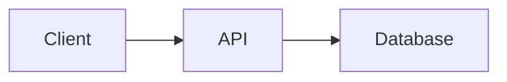

# Project NN — Project Title

<!--
AUTHORING RULES (delete when written)
- Write the brief BEFORE any reference solution. Solutions live in a separate reference-solution/
  folder with a warning header.
- Requirements must be testable. "The app should be fast" is not a requirement; "list view renders
  in under 300 ms with 10,000 records" is.
- Every project names the competencies it assesses, so learners can trace it back to lessons.
- Prerequisites link to actual lesson files; a project never assumes a lesson not yet written.
-->

## 1. Problem statement

The real-world situation, in two or three paragraphs. Who has this problem, what does it cost them,
and what does "solved" look like for them?

## 2. Intended users

| User | Goal | Skill level | Accessibility needs |
|---|---|---|---|
| | | | |

## 3. Functional requirements

Numbered, testable statements. FR-1, FR-2, …

## 4. Non-functional requirements

| ID | Requirement | Measurable target |
|---|---|---|
| NFR-1 | Performance | e.g. p95 response under 300 ms at 100 concurrent users |
| NFR-2 | Security | e.g. no plaintext passwords at rest; all authz enforced server-side |
| NFR-3 | Reliability | e.g. graceful handling of every network failure |
| NFR-4 | Usability | e.g. keyboard-operable, works at 360 px width |

## 5. Prerequisites

| Lesson | Why needed here |
|---|---|
| [link](../path) | e.g. transactions — FR-5 requires atomic updates |

## 6. Architecture

What you are expected to build, at block level. Include a diagram and explain its elements in
prose. State explicitly which architectural decisions are **yours to make** (and will be judged)
versus given.

## 7. Data model

Tables/entities, keys, relationships. State the required constraints; leave the rest to the learner.

## 8. API contract (where relevant)

| Method | Path | Purpose | Auth | Success | Error cases |
|---|---|---|---|---|---|
| POST | `/api/...` | | required | 201 + body | 400, 401, 409 |

## 9. UI requirements (where relevant)

Screens, states (loading, empty, error, success), and accessibility requirements. Include a
wireframe sketch (hand-drawn scan or simple SVG is fine) showing required elements, not styling.

## 10. Folder structure

The required skeleton, with one line per entry explaining its purpose.

## 11. Milestones

| # | Milestone | Deliverable | Depends on |
|---|---|---|---|
| M1 | | | |
| M2 | | | M1 |

## 12. Implementation tasks

A starter breakdown for M1 only — enough to unblock, not enough to copy. Learners write the rest.

## 13. Testing strategy

Which level tests which requirement. What must be covered; what deliberately should not be tested.

| Requirement | Test level | Notes |
|---|---|---|
| FR-3 | integration | must prove rollback on failure |

## 14. Security requirements

Concrete controls with observable verification, e.g. "passwords hashed with Argon2/bcrypt —
verified by a test that fails if plaintext storage is reintroduced".

## 15. Deployment plan

What must be running where, with what health check and rollback path. (Scoped to what the learner
has studied by this point in the curriculum.)

## 16. Documentation requirements

README sections required, one ADR required (which decision is up to the learner), and an API
description a stranger could call.

## 17. Acceptance criteria

A checklist a reviewer can run top to bottom. Every item observable and binary.

- [ ] AC-1 …
- [ ] AC-2 …

## 18. Extension challenges

Harder variants for learners who finish early or return later. Each states what it teaches.

## Solutions policy

Reference solutions exist in [reference-solution/](reference-solution/README.md) **after** the brief.
They are for checking your work and comparing approaches — not for producing it. A solution read
before the attempt teaches nothing and is easy to detect in review.